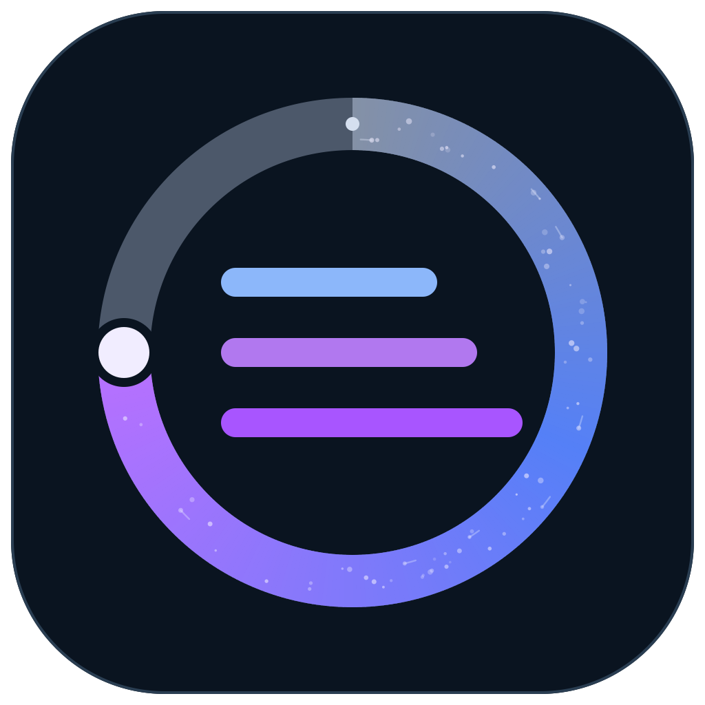

# Context Manager

The early-compaction fix is disabled because it replaces the Codex core with a modified binary lacking the official Codex signing identity, which can prevent Computer Use from working. The 920K extension only changes configuration and keeps the official runtime.

920K extension is verified against the native 0.163.0-alpha.10.2 runtime using local integration fixtures (window readback, compaction guards, and off/on transitions). It no longer requires an exact runtime version. The optional early-compaction patched runtime remains disabled.

0.16.2 uses a DMG installer and ships only the o200k tokenizer dictionary. App names and runtime versions are not allowlisted; unrecognized runtimes pass through. Future protocol changes may still require adaptation; each chat’s window is confirmed from runtime readback.

**English** | [简体中文](README.zh-CN.md)



Manage Codex context budgets from the macOS menu bar. Adjust each chat’s usable window, inspect input and cache usage, and review estimated API costs.

**0.16.2 · Apple Silicon · macOS 14+ · English / 中文 · MIT**

## Demo

https://github.com/user-attachments/assets/da7d0fd3-1b86-46e6-ac8f-0abca71e1c94

[Download the original English 1080p demo (MP4, about 137 MB)](https://github.com/Fandy-ust/codex-context-control/releases/download/demo-2026-10-17/context-manager-demo-en-1080p.mp4) · [Demo release](https://github.com/Fandy-ust/codex-context-control/releases/tag/demo-2026-10-17)

1920 × 1080 · 4 min 6 sec · English narration and captions. The inline player uses a smaller full-length 1080p encode. [Watch the Chinese demo](README.zh-CN.md#演示视频).

## Install

[Releases](https://github.com/Fandy-ust/codex-context-control/releases) · [Installation guide](docs/en/INSTALL_MAC.md) · [Changes](CHANGELOG.md)

**[Download 0.16.2 for Apple Silicon (DMG, about 45 MB)](https://github.com/Fandy-ust/codex-context-control/releases/download/v0.16.2-preview.1/Context-Manager-0.16.2-macos-arm64.dmg)** · [Release notes](https://github.com/Fandy-ust/codex-context-control/releases/tag/v0.16.2-preview.1)

The English / Chinese preview installer is publicly available. The demo release contains the video; use the app download above to install Context Manager.

1. Obtain `Context-Manager-0.16.2-macos-arm64.dmg` and open it.
2. Open **Install Context Manager.app** and choose **Install / Update**.
3. Fully quit and reopen Codex after the first installation or a bridge upgrade.
4. Click the ring icon in the menu bar to open your chats and settings. Optionally review the Stop hook in Codex’s `/hooks` for Hook stats.

No Node, npm, Homebrew, or Xcode is needed to use the installer. Install the Codex / ChatGPT desktop client first. 920K integration is verified with **Codex 0.163.0-alpha.10.2** using local test fixtures.

Preview packages are locally signed and are **not Developer ID signed or Apple notarized**. On a trusted preview, follow the macOS Privacy & Security prompt to allow opening. Users do not need a developer membership. [Installation details](docs/en/INSTALL_MAC.md)

## Language

Choose **Automatic (time zone)**, **中文**, or **English** inside the app or installer. Changes apply immediately and are saved locally.

Automatic mode uses Chinese for mainland China, Hong Kong, Macao, and Taiwan time-zone identifiers, and English elsewhere. It checks the zone name, not just the UTC offset: Singapore and Perth do not become Chinese merely because they are UTC+8. A manual selection always wins. Chat titles, model identifiers, and saved budgets are preserved.

## Features

- **Per-chat budgets:** 1K steps, with actual observed capacity shown separately from a pending target.
- **Global defaults:** new chats inherit your defaults; forks inherit their parent’s budget. Existing chats remain independent.
- **Optional context extension:** up to 920K usable context, with compaction by 904K and at least 16K reserved for the next turn. Native limits apply when disabled.
- **Context details:** input, cache reads, estimated cache writes, standard-rate API cost estimates, generation speed, and compaction events on aligned charts.
- **Responsive charts:** background aggregation, incremental history processing, bounded caches, coalesced pointer updates, and deferred refresh during interaction.
- **Recent chats:** running chats first, then real activity time; recently completed chats stay available.
- **Optional early-compaction fix:** a separate toggle and optional patched runtime. The large runtime is not part of the main installer.

New installations leave extension disabled. Upgrades preserve budgets and toggles. The 920K ceiling is a local control limit, not a guarantee of every server-side model’s capacity. Switching a running core mode requires restarting Codex.

## Update or uninstall

Run a newer installer and choose **Install / Update**. The menu bar app is replaced and restarted; restart Codex to load a new bridge. Budgets, preferences, and backups are retained. You can delete the downloaded installer afterward.

To uninstall, reopen the installer and choose **Uninstall**. Budgets and backups remain.

## Documentation

| Using the app | Development |
| --- | --- |
| [Installation](docs/en/INSTALL_MAC.md) | [Development](docs/en/DEVELOPMENT.md) |
| [Usage and language](docs/en/USAGE.md) | [Architecture](docs/en/ARCHITECTURE.md) |
| [Context extension](docs/en/CONTEXT_EXTENSION.md) | [Packaging and releases](docs/en/RELEASING.md) |
| [Privacy](docs/en/PRIVACY.md) | [Localization](docs/en/LOCALIZATION.md) |
| [Chinese documentation](README.zh-CN.md) | [Research and validation index](docs/en/README.md) |

## Build locally

Development requires Node.js 22.13+ and Apple Command Line Tools.

```sh
npm ci --ignore-scripts
npm test
npm run build:mac
npm run install:local
```

For a release build, commit changes and run `npm run package:mac -- --release` from a clean tree. The **macOS installer** GitHub Actions workflow can also build and validate the package; it does not publish a Release automatically.

Packages include a pinned, checksummed Node runtime and production dependencies. They do not contain account credentials, chat history, personal settings, or the large optional patched runtime.

## License

[MIT](LICENSE). You may use, modify, distribute, and sell copies subject to the copyright and permission notice requirements. [Third-party components](THIRD_PARTY_NOTICES.md) keep their own licenses.

This is an independent project, not affiliated with OpenAI.
