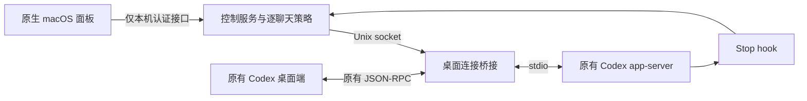

# 架构与 Codex 接入

## 所有权

Codex 为每个线程持有自己的 SessionConfiguration 和 ModelInfoOverrides。模型目录等服务可以共享，但窗口覆盖值由聊天各自持有。仅修改 config.toml 不会更新现有会话捕获的窗口参数。

本项目利用已在真实运行时验证的路径：目标聊天空闲且没有订阅者时，带配置覆盖的 thread/resume 可以重新构建该聊天。



## 为什么需要专用启动入口

桌面端通过自己的连接订阅聊天。单独启动一个旁路客户端，不能取消桌面端的订阅，也就不能利用这条重新加载路径。

Launcher 仅为它启动的进程设置 `CODEX_CLI_PATH`，指向本项目的透传包装器。包装器运行原来的 Codex 二进制，并保持前端 JSON-RPC 的请求、响应、通知和反向工具调用。内部控制请求使用独立随机 ID，不会返回给前端。`--version`、schema 工具和其他命令直接透传。

安装程序不替换签名应用、不设置全局 launchctl 环境、不改用户的模型提供方与登录凭据。辅助运行时文件通过安装目录中的符号链接保持可发现。

`CODEX_CLI_PATH` 的桌面使用属于本地实现接入点，不应当视为稳定的第三方插件 API。每个新运行时版本需要重新验证。

## 应用事务

1. 规范化输入和预检，使用模型目录中的最大值与可用比例。
2. 活跃轮次排队；空闲时，仅锁住目标聊天的新输入和设置请求，其他聊天继续转发。
3. 读取当前聊天设置快照。
4. 取消本连接的订阅。
5. 用相同 threadId 恢复，合并新的窗口、压缩阈值和 total scope。
6. 恢复实际模型、权限、推理设置、协作模式和插件禁用列表，并保留原有开发者/基础指令覆盖。动态工具由 Codex 的持久化恢复机制保留。
7. 放行目标聊天队列，状态标为等待下一轮确认。
8. 只有 thread/tokenUsage/updated 报告的窗口与预期相符，才标记窗口已确认。

失败会尝试重新加入原聊天。无法无损表示的沙盒策略、临时聊天或父代理管理的聊天在取消订阅之前拒绝。异常状态不会被当作已生效。

这里的“热调整”是轮次之间重新加载单个聊天。已经发送的请求不会被追改。

## 预检

当前版本只支持 total scope：

```
raw_window = requested_window（不得超过当前目录 max_context_window）
usable_window = floor(raw_window × effective_context_window_percent / 100)
effective_compact = min(requested_compact, floor(raw_window × 0.9))
```

将必须保留量、下一轮预留、最近请求用量分别与容量及压缩阈值比较。用量或模型元数据未知时，等待观测；不会把未知值当作零。

最近请求用量来自运行时 last usage，不使用累计 usage。它不包含所有可能的内核估算和下一步内容，所以属于保守设计中的一个观测量，不能证明任意后续操作均不会触发压缩。手动保留下限是用户指定的约束，不是对加密压缩状态的测量。

## 保存内容

控制服务只持久保存聊天 ID、标题/目录、模型、状态、窗口、用量统计和预算。开发者指令、工具定义等为恢复设置所需的信息仅在桥接进程内存中保留，不写入控制服务状态文件。

## 参考

- [官方 App Server 协议](https://learn.chatgpt.com/docs/app-server)
- [官方 Hooks](https://learn.chatgpt.com/docs/hooks)
- [0.160.0 的会话设置](https://github.com/openai/codex/blob/rust-v0.160.0/codex-rs/core/src/session/step_settings.rs)
- [0.160.0 的运行中聊天恢复逻辑](https://github.com/openai/codex/blob/rust-v0.160.0/codex-rs/app-server/src/request_processors/thread_processor.rs)
- [0.160.0 的窗口与阈值计算](https://github.com/openai/codex/blob/rust-v0.160.0/codex-rs/protocol/src/openai_models.rs)
