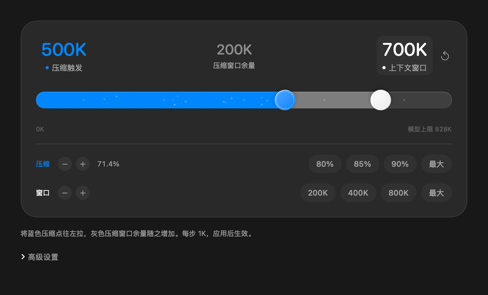

# 控制面板样式

原生 SwiftUI 界面参考 Codex 深色面板：接近黑色的背景、深灰圆角容器、细边框和带轻微流动光点的胶囊轨道。聊天列表使用低对比度选中背景。

图片由真实原生控件使用合成预算渲染，仅用于展示样式，不代表当前聊天的运行时状态。

轨道高度为 26 点，带细微的明暗渐变边缘。取消轨道外围的蓝色焦点框和系统焦点光晕，保留键盘聚焦与调节；选中的目标由上方数值的轻微底色标识。

## 同一条轨道，两个滑块

- 蓝色滑块是压缩触发点，白色滑块是上下文窗口上限，直径均为 32 点，带渐变底色、内外细高光和柔和投影。
- 两点共用模型容量刻度，中间数值标为“压缩窗口余量”。中间灰色段表示窗口上限与压缩阈值的差；向左拖动蓝色点会增加这段余量。
- 灰色余量不是“压缩后保留量”，也不是高级设置中的“下一轮预留”；它直接等于窗口减去压缩阈值。
- 窗口右侧的深灰轨道表示尚未使用的可设置容量，最右侧标出模型上限。
- 点击或拖动轨道时选择最近的滑块；一次拖动期间不会切换目标。两个点过于接近时，可先点选上方对应数值再拖动，或使用对应的 − / ＋。
- 滑块、微调按钮和左右方向键均按 1K 调整。点选上方数值可选择键盘调整的目标。
- 移动白色窗口滑块时，压缩阈值保留原有比例联动；移动蓝色压缩点会改变比例。保留容量预设、比例预设和最大值快捷按钮。
- 原有模型上限、压缩上限和提交预检继续适用，蓝色点不能越过允许的压缩上限。
- 右上角回转箭头重新载入已保存预算；拖动草稿后，仍须点击应用才提交。
- 辅助功能表示保留两个独立原生滑条及其名称、K 值和边界，供读屏与辅助调节使用。

## 动效

蓝色压缩点在模型刻度上越靠右，光点单位长度密度和流速越高；右侧增加较短的粒子流，使末端更密集。每个光点沿轨道向右加速，边缘淡入淡出。粒子总数最多 40，粒子数量变化以透明度过渡。运动相位按实际经过时间累加，调整预算会改变速度，不会重设粒子位置。

仅粒子控件按最高约 30 帧/秒刷新；失去应用焦点、禁用控件或开启“减少动态效果”时停止更新。数值和滑块在非拖动变化时保留短暂过渡，减少动态效果时关闭。滑块靠得很近时，当前选中的滑块显示在上层。

## 验证范围

本次改变仅涉及原生界面。已编译并检查原生控件渲染；本机只替换设置应用，控制服务、桥接、逐聊天预算与全局配置不随此次 UI 部署改写。显示图片为静态预览，实际动态效果在打开的面板中查看。
