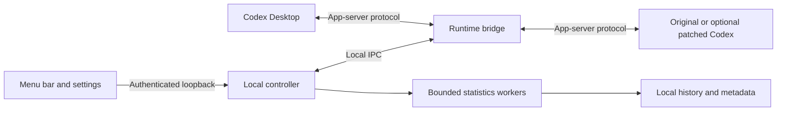

# Architecture and runtime connection

**English** | [简体中文](../ARCHITECTURE.md) · [Home](../../README.md)

The desktop UI, local controller, and runtime bridge have separate responsibilities.

## Per-chat state

The controller stores budgets and monotonically increasing revisions per chat. Runtime observations are distinct from saved targets. A normal request must report the expected actual window before the UI marks it confirmed. Late observations cannot overwrite newer budget revisions.

A config file edit alone does not update an existing session’s captured runtime configuration. The bridge applies overrides through supported app-server operations between turns, preserving the chat’s instructions, tools, permissions, model, and service tier. Pending input is held while a protected reload is in progress.

Global defaults apply to newly created user chats. Forks take an independent parent-policy snapshot. Temporary or parent-managed sessions are excluded.

## Startup and shutdown

On macOS, installation registers a stable runtime entry for Codex’s GUI environment and a native menu bar companion. It preserves the signed original app. The controller can upgrade only an older service whose process path it verifies. The main Codex client is not forcibly restarted by a controller update.

A supported optional patched runtime and context extension are selected independently. Already-running core processes need a normal client restart to load a different core configuration.

## Statistics and responsiveness

At most two workers analyze histories; duplicate requests for the same chat merge, and excess distinct work is rejected with a retry message. Projected events and file/index dependency checks keep growing histories incremental and avoid unnecessary reanalysis. Unchanged results reuse worker and serialized HTTP output. Idle workers retire.

The native UI decodes and aggregates outside the interaction path. Charts use bounded intervals, cached presentation data, and coalesced pointer updates. Interaction temporarily defers automatic refresh. Missing usage or timing is preserved as missing.

## Language

Native UI and Node hooks share `src/locales/en.json` and a local `language.json` preference. Language resolution uses IANA zone identifiers in automatic mode, with manual selection taking precedence. Runtime state and budgets remain language-independent; only display text is translated. See [localization](LOCALIZATION.md).
